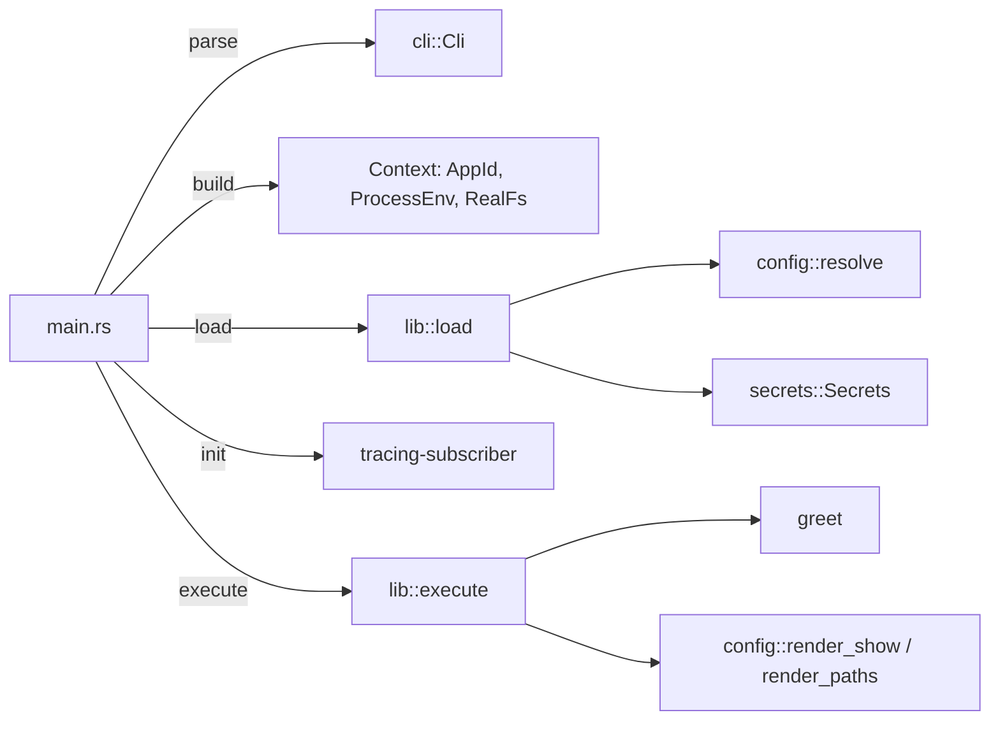
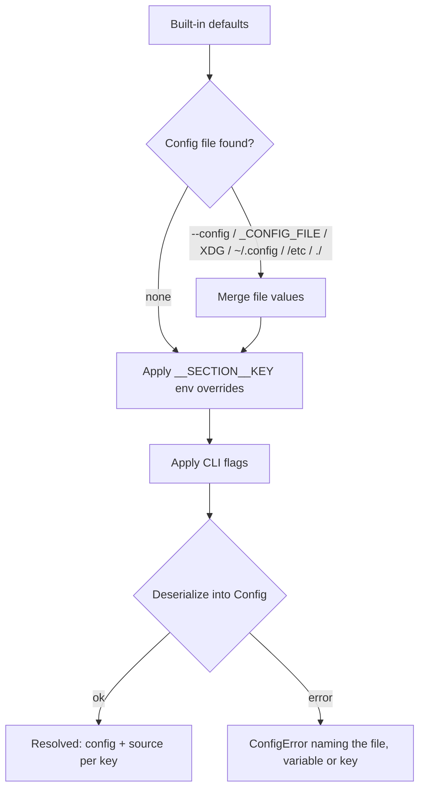

# Architecture

## Overview

`{{project-name}}` is a command-line application split into a thin binary (`src/main.rs`) and a library (`src/lib.rs`) that holds all logic. The library never touches the real process environment or filesystem directly: they are injected through the `Env` and `FileSystem` traits, so every behaviour is unit-testable.

## Modules

| Module | Responsibility |
| --- | --- |
| `main.rs` | Parse args, build the real `Context`, load config, start logging, run, map errors to exit codes. |
| `lib.rs` | `load` and `execute`, the `Error` type, exit codes. |
| `cli` | `clap` definitions and conversion of flags to config values. |
| `config` | Schema and defaults (`mod.rs`), resolution (`resolve.rs`), diagnostics (`show.rs`). |
| `env` | `Env` trait, `ProcessEnv` (process environment over `.env`), `MapEnv` (tests). |
| `fs` | `FileSystem` trait, `RealFs`, `MemFs` (tests). |
| `secrets` | Secrets from the environment, held in `SecretString`. |
| `app_id` | Application name and the environment prefix derived from it. |

## Configuration resolution

## Key decisions

- **In-house config resolution.** Precedence, override parsing and provenance are explicit and testable without mutating the process environment, which is `unsafe` in Rust 2024.
- **Every config key has a default.** Defaults define each key's type, which is how environment override strings are parsed.
- **Secrets are separate from config.** They never appear in `config.toml`, overrides or `config show` output.
- **Exit codes follow `sysexits.h`.** `78` for configuration errors, `74` for output errors.
